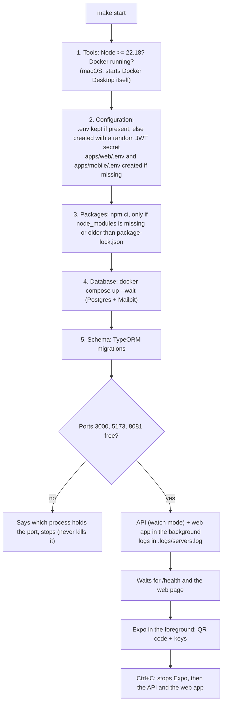

# 1. Running it on any laptop

## What the laptop needs

| Tool | Why | Check |
|---|---|---|
| **Docker Desktop**, started | Runs Postgres and Mailpit (the fake mail inbox) | `docker info` |
| **Node.js ≥ 22.18** | Runs the API, the web app and Expo. 22.18 is the first version that loads the shared TypeScript package without a build step | `node -v` |
| **Git** | To get the code | `git --version` |
| For the phone: **Expo Go**, on the same Wi-Fi | Opens the mobile app from a QR code | — |

Nothing else: no global packages, no database install.

## One command

```bash
git clone <repo-url> music-room && cd music-room
cp /path/to/your/.env .env        # optional: your .env with the Google / Facebook keys
make start
```

`make start` runs [`scripts/start.sh`](../../scripts/start.sh), which first runs [`scripts/setup.sh`](../../scripts/setup.sh). Every setup step is skipped when it's already done, so `make start` is also the everyday command.



When it's ready it prints:

```
HOLY is running
Web app        http://localhost:5173
API docs       http://localhost:3000/api-docs
Emails (codes) http://localhost:8025
Phone (Expo Go, same Wi-Fi): Server settings → http://<laptop IP>:3000
Server logs    make logs   (in another terminal)
```

| Command | What |
|---|---|
| `make start` | Everything (setup, API, web, Expo) |
| `make start-web` | The same without Expo |
| `make setup` | Only the setup steps |
| `make logs` | Follow the API and web logs, including the JSON action log (V.6) |
| `make help` | Every target |

**Why Expo runs in the foreground:** Expo only shows its QR code and accepts keys (`a` Android, `r` reload) when it owns a real terminal. Started next to the others (for example with `concurrently`), it runs "non-interactive" with no QR code. So the API and the web app go to the background with their output in a log file, and Expo gets the terminal.

## The `.env` files

| File | Created by setup when missing | Holds |
|---|---|---|
| `.env` (repo root) | From `.env.example`, with a **fresh random** `JWT_ACCESS_SECRET` | Database, JWT, mail, Google / Facebook keys, `WEB_ORIGINS`. Read by the API and Docker Compose |
| `apps/web/.env` | From its example | `VITE_API_URL` (default API address of the web app) |
| `apps/mobile/.env` | From its example; the API address is set to the laptop's **Wi-Fi IP** | `EXPO_PUBLIC_API_URL` (default API address of the app) |

All three are git-ignored. Setup never overwrites an existing one, and never prints a secret's value.

**Bringing your own `.env`** (with the Google / Facebook keys): copy it to the repo root before `make start`. Without it, setup generates one: email + password works fully, and the Google / Facebook buttons fail at the provider (no keys).

## Using the apps

- **Web:** open http://localhost:5173. Register, then the 6-digit code arrives in Mailpit (http://localhost:8025).
- **Phone:** scan the QR code with Expo Go (Android) or the Camera (iOS). On the first screen, **Server: … · change** must show `http://<laptop IP>:3000` (setup put it in `apps/mobile/.env`; it can be changed in the app at any time, brief V.5).
- **Android emulator:** press `a` in the Expo terminal. The API address for the emulator is `http://10.0.2.2:3000`. For Google sign-in run `adb reverse tcp:3000 tcp:3000` after each emulator start.

## Google / Facebook on another laptop

Google and Facebook only send the browser back to **registered** addresses. The registered callbacks are `http://localhost:3000/auth/google/callback` and `http://localhost:3000/auth/facebook/callback`.

| From | Works? | Why |
|---|---|---|
| The web app on the laptop | Yes (with the keys) | The browser is on the laptop, so `localhost:3000` is the API |
| The Android emulator | Yes, after `adb reverse tcp:3000 tcp:3000` | The emulator's `localhost:3000` is forwarded to the laptop |
| A real phone | Only through a public HTTPS address (ngrok, README → "Testing on a real phone") | On a phone, `localhost` is the phone itself |

## When something goes wrong

| What you see | Cause → fix |
|---|---|
| `Node … is too old` | `nvm install 22 && nvm use 22`, then `make start` |
| `Docker is not running` | Start Docker Desktop, then `make start` |
| `Port 3000 is already in use by PID …` | Another API is running (often in another terminal): stop it, or `kill <PID>` |
| `The API didn't start` + log lines | Read them: usually a bad value in `.env` |
| The phone can't reach the server | Same Wi-Fi? The address in Server settings must be the laptop's IP. Some school / guest Wi-Fis block devices from seeing each other → use the emulator, or a phone hotspot |
| `relation … does not exist` | Migrations didn't run: `make setup` |
| A test account needs its code | Mailpit: http://localhost:8025 |

## Files to open

| File | What |
|---|---|
| `scripts/setup.sh` | The five setup steps |
| `scripts/start.sh` | Ports check, background servers, Expo in the foreground, clean stop |
| `Makefile` | Every command (`make help`) |
| `docker-compose.yml` | Postgres 16 and Mailpit, bound to 127.0.0.1 only |
| `.env.example`, `apps/*/.env.example` | Every setting, with comments |
