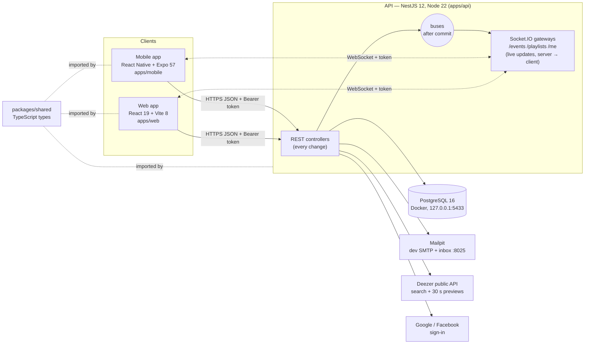
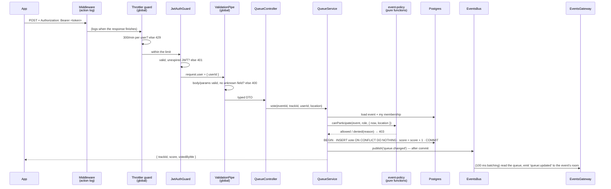
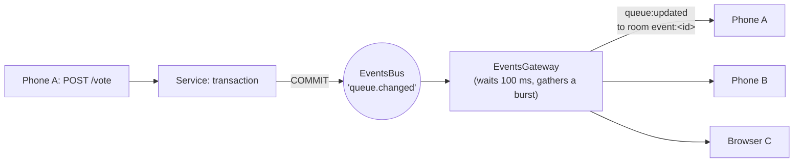

# 2. Architecture

## The parts



| Part | Choice | Why |
|---|---|---|
| API | **NestJS 12** on Node 22 | One module per area (auth, users, friends, music, events, playlists, me, security). Dependency injection keeps services small and testable; guards, pipes and interceptors apply rules to every route in one place |
| Database | **PostgreSQL 16 + TypeORM** | What must stay right under concurrency (votes, the playing track, playlist order, friendships) is guaranteed by **transactions and constraints**, not by app code. The schema only changes through **migrations** (`synchronize: false`) |
| Realtime | **Socket.IO** (Nest gateways) | Rooms per event / playlist / user, reconnection and acknowledgements built in. The socket only **sends** news; every change goes through REST, so it's validated, authorised, rate-limited and logged in one place |
| Mobile | **React Native + Expo SDK 57**, expo-router | One codebase for Android and iOS, run in Expo Go during development |
| Web | **React 19 + Vite 8**, React Router 7 | The same screens for a browser (the bonus), on the same API and sockets |
| Shared types | `packages/shared` (raw `.ts`) | One definition of every request / response shape: a change is a compile error in all three apps, not a runtime surprise |
| Music | **Deezer** public API | Search and 30-second previews without an API key. Always called **through our API** |
| Mail | SMTP; **Mailpit** in development | Verification and reset codes; Mailpit catches everything and shows it in a web inbox |

**Why not Firebase / Supabase?** The brief says the SDK must not do the work. A managed backend would hide what's graded: auth, access rules, real-time sync and concurrency. With NestJS + Postgres every rule is our code.

**The apps are remote controls.** The server re-checks every rule on every request: who can see, vote, edit, play, and which parts of a profile. The apps only display what the API returns.

## The monorepo

```
music-room/
├── apps/
│   ├── api/        NestJS API: src/<area>/ (controller, service, entities, dto, policy, gateway), src/migrations/, test/ (concurrency, realtime, security scripts)
│   ├── mobile/     Expo app: src/app/ (screens = routes), src/session, src/player, src/ui …
│   └── web/        Web app: src/pages/, src/session, src/player, src/ui …
├── packages/shared/  src/index.ts: the API's contracts (types + a few constants and one shared rule)
├── scripts/        setup.sh, start.sh (make setup / make start)
├── loadtests/      k6 load tests (V.7)
└── docs/           openapi.json, realtime.md, security.md, technical/
```

One **npm workspace**: one `npm ci` installs all of it, and one lockfile pins every version.

**How the shared package is loaded without a build:** its `package.json` points straight at `src/index.ts`.
- The **API's Node** (≥ 22.18) strips the TypeScript types itself when it loads the file. That's why the file uses only "erasable" syntax: no `enum`, no `namespace`.
- **Metro** (mobile) and **Vite** (web) compile TypeScript anyway.

## Inside the API: what a request goes through

Example: `POST /events/:id/tracks/:trackId/vote`.



| Layer | Where | What it guarantees |
|---|---|---|
| **Action-log middleware** | `common/action-log.ts` | One JSON line per request when it finishes (method + route pattern, status, time, user, IP, client platform / device / version). Middleware rather than an interceptor, so refused requests (401, 429) are logged too. Bodies, query strings and tokens are never logged |
| **Throttler guard** (global) | `security/` | Rate limits; see [Accounts](04-auth.md#rate-limits) |
| **JwtAuthGuard** (per route) | `auth/jwt-auth.guard.ts` | A valid access token. `OptionalJwtAuthGuard` is for the two routes that also answer without one (public profiles, people search) |
| **ValidationPipe** (global) | `main.ts` | `whitelist` + **`forbidNonWhitelisted`**: a field the DTO doesn't declare is a 400. So nobody can sneak in `ownerId`, `score` or `emailVerifiedAt`. `transform` turns the body into the DTO class |
| **ClassSerializerInterceptor** (global) | `main.ts` | Entity fields marked `@Exclude()` never leave the server (password hash, provider ids, profile fields). Only what's marked `@Expose()` is added (e.g. `emailVerified`) |
| **Controller** | `<area>/*.controller.ts` | Routes, Swagger descriptions; no logic |
| **Service** | `<area>/*.service.ts` | The work: loads, checks the policy, writes in transactions, publishes on the bus |
| **Policy** | `*-policy.ts` | "May this user…?" as pure functions, used by REST and sockets alike, unit-tested |
| **Entities + migrations** | `*.entity.ts`, `migrations/` | The tables and their constraints |

**404 or 403?**
- Something **private** you're not a member of answers **404**, as if it didn't exist: its existence isn't revealed.
- Something you **can see but not do** answers **403**, with a `reason` the app can explain (`not_invited`, `outside_area`…).

## Realtime: how a change reaches every screen



- **Published after commit.** No client hears about a change that could still roll back.
- **The bus is an in-process event emitter.**
  - The services contain no WebSocket code.
  - It breaks a module cycle: the gateway needs the service for access checks.
  - With several servers it would become Redis pub/sub (see [security.md](../security.md) → accepted risks).
- **Joining a room** runs the same `canView` as the REST route. A private event's room is members-only.
- **When access changes** (visibility, an invitation), the gateway re-checks every socket in the room. The ones that lost access get `event:access-lost` and are removed.
- **Connecting needs a valid access token** in the handshake (`auth.token`). An expired one gets `connect_error: unauthorized`: the app refreshes and reconnects.
- **Three namespaces:**

| Namespace | Room | Sends | Style |
|---|---|---|---|
| `/events` | `event:<id>`, after `event:join` | `queue:updated`, `event:updated`, `event:deleted`, `event:access-lost` | The **whole ranked queue**, batched every 100 ms: a vote can reorder everything, and a full snapshot is always correct |
| `/playlists` | `playlist:<id>`, after `playlist:join` | `track:added`, `track:moved`, `track:removed`, `playlist:updated`, `playlist:deleted`, `playlist:access-lost` | **Small deltas**: a fractional position is absolute, so each message can be applied on its own, in any order |
| `/me` | `user:<id>`, chosen from the token on connect | `friends:changed` | Nothing to join: you can only ever receive your own messages |

**Joining before loading.** An app first joins the room, *then* loads the data. A change made between the two can't be missed: it arrives as a message, or it's already in the loaded data. After each reconnection the app reloads.

## Configuration

Everything comes from environment variables: the root `.env` in development, read by `ConfigModule`, the TypeORM CLI (`data-source.ts`) and Docker Compose. The full list with explanations is in the [README](../../README.md#configuration-env-at-the-repo-root). The ones that matter for the architecture:

| Variable | Effect |
|---|---|
| `DB_*` | Postgres connection (Compose publishes it on 127.0.0.1:`DB_PORT`) |
| `JWT_ACCESS_SECRET`, `JWT_ACCESS_EXPIRES` (15m), `JWT_REFRESH_EXPIRES` (7d) | Token signing and lifetimes |
| `WEB_ORIGINS` | The web app's origins: CORS + allowed social-login return page |
| `API_PORT` | A value given on the command line wins over `.env` (a second instance for load tests) |
| `RATE_LIMIT_PER_MINUTE`, `AUTH_ATTEMPTS_PER_*` | The limits |

The **server address is a runtime setting in both apps** (brief V.5): "Server settings" is reachable from the sign-in screen and from Profile, and it's saved on the device. The build-time value (`EXPO_PUBLIC_API_URL`, `VITE_API_URL`) is only the default.

## Files to open

| File | What |
|---|---|
| `apps/api/src/main.ts` | Global pipe + serializer, CORS, Swagger, port, optional ngrok |
| `apps/api/src/app.module.ts` | Config, database connection, every module, the action-log middleware |
| `apps/api/src/*/…-bus.ts`, `*.gateway.ts` | Buses and the three namespaces |
| `apps/api/src/common/action-log.ts` | The action log (HTTP and sockets) |
| `packages/shared/src/index.ts` | Every contract between the API and the apps |
| `docs/realtime.md` | Every socket message in detail |
