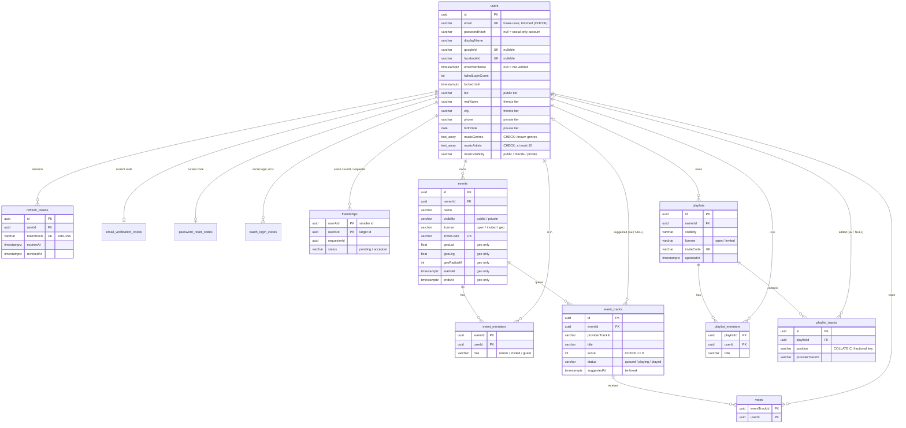

# 3. Data model

13 tables in PostgreSQL 16, all created by the 12 migrations in `apps/api/src/migrations/`. Primary keys are UUIDs (`uuid_generate_v4()`). Times are `timestamptz`.

## The diagram

## The rules the database itself enforces

App checks can race: two requests both "check, then write". Constraints can't. Every rule that has to survive concurrency is a constraint:

| Rule | Constraint | What happens when it fires |
|---|---|---|
| One account per email, whatever the case | `UNIQUE(email)` + `CHECK (email = lower(btrim(email)))` | 409 "Email is already registered" (two simultaneous registrations: one wins) |
| One Google / Facebook account per user | `UNIQUE(googleId)`, `UNIQUE(facebookId)` | Linking → 409; two simultaneous first logins → the second finds the first's row |
| **One vote per person per track** | `votes` primary key `(eventTrackId, userId)` | `INSERT … ON CONFLICT DO NOTHING`: the second insert does nothing, the score isn't touched |
| A score is never negative | `CHECK (score >= 0)` | — (votes and the score change in the same transaction) |
| **A song only once in the waiting queue** | partial unique index `(eventId, provider, providerTrackId) WHERE status = 'queued'` | 409 "already in the queue"; once played it can be suggested again |
| **At most one track playing per event** | partial unique index `(eventId) WHERE status = 'playing'` | — (the `next` transaction also locks the event row) |
| A geo event has its whole area and window; others have none | `CHECK (("license" = 'geo') = (all 5 geo columns NOT NULL))`, ranges, `startsAt < endsAt` | 400 from the service first; the CHECK is the safety net |
| **Two tracks never share a playlist position** | unique index `(playlistId, position)` | The service re-reads the neighbours and retries ([Playlist Editor](07-playlist-editor.md)) |
| A song only once per playlist | unique index `(playlistId, provider, providerTrackId)` | 409 "already in the playlist" |
| **One friendship row per pair** | primary key `(userAId, userBId)` + `CHECK (userAId < userBId)` | "A asks B" and "B asks A" are the same row: asking each other at the same time = friends ([Profiles and friends](05-profiles-friends.md)) |
| The requester is one of the pair | `CHECK (requesterId IN (userAId, userBId))` | — |
| Known values only | `CHECK` on every status / role / visibility / license; genres ⊂ the list; ≤ 10 artists | 400 from validation first |
| One verification / reset code per user at a time | `UNIQUE(userId)` on each code table | A new code replaces the old one (delete + insert in one transaction) |
| A refresh token is stored once | `UNIQUE(tokenHash)` | — |
| An invite code is unique | `UNIQUE(inviteCode)` on events and playlists | Creation retries with a new code (≈ never needed: 31⁸ codes) |

## What happens on delete

| Deleted | Cascades to | Kept (`SET NULL`) |
|---|---|---|
| A user | sessions, codes, memberships, votes, friendships, **the events and playlists they own** | tracks they suggested / added **in other people's** events and playlists stay, with no author |
| An event | members, tracks, votes | — |
| A playlist | members, tracks | — |

## Choices worth knowing

- **Track details are a snapshot taken by the server** (title, artist, cover, duration from Deezer at suggest / add time), never values sent by the app. The app only sends `providerTrackId`.
- **No stored preview URL.** Deezer's preview links expire after about 15 minutes, so a fresh one is fetched right before playing (`GET /music/tracks/:id/preview`).
- **`playlist_tracks.position` uses `COLLATE "C"`.** That's plain byte order. The default collation follows language rules and would sort `"Zz"` after `"a0"`, breaking the order.
- **Counters are not recomputed.** `event_tracks.score` changes only by `score = score ± 1` inside the vote's transaction, so it always equals the number of `votes` rows.
- **Secrets are hashed:**
  - refresh tokens: SHA-256;
  - email codes: SHA-256 salted with the purpose and the user id;
  - social login codes: SHA-256;
  - passwords: bcrypt, cost 12.

  A database leak gives nothing replayable.
- **Indexes for each "list mine" query:** `event_members(userId)`, `playlist_members(userId)`, `votes(userId)`, `friendships(userBId)`, `refresh_tokens(userId)`. The ranked queue is served by `(eventId, status, score, suggestedAt)`.

## Migrations

The schema's source of truth: `synchronize` is off.

1. Change an entity.
2. `make migration-generate name=WhatChanged`: TypeORM diffs the entities against the database and writes the SQL.
3. **Read the SQL.**
4. `make migrate`. `make migration-revert` undoes the last one.

`make setup` applies them all on a new laptop.

| Migration | Adds |
|---|---|
| `InitialUsers`, `NormalizedEmailCheck` | `users`, the lower-case email CHECK |
| `RefreshTokens` | sessions |
| `EmailVerification`, `PasswordReset` | the code tables, `emailVerifiedAt` |
| `GoogleSignIn`, `FacebookSignIn` | `oauth_login_codes`, `googleId`, `facebookId`, password-less accounts |
| `TrackVote`, `OnePlayingTrack` | events, members, tracks, votes, the partial unique indexes |
| `PlaylistEditor` | playlists, members, tracks with `COLLATE "C"` positions |
| `UserProfile` | profile tiers, music preferences, `friendships` |
| `LoginLockout` | `failedLoginCount`, `lockedUntil` |

## Files to open

| File | What |
|---|---|
| `apps/api/src/**/*.entity.ts` | Each table, with comments on every constraint |
| `apps/api/src/migrations/` | The SQL, in order |
| `apps/api/src/data-source.ts` | The TypeORM CLI's connection (migrations) |
