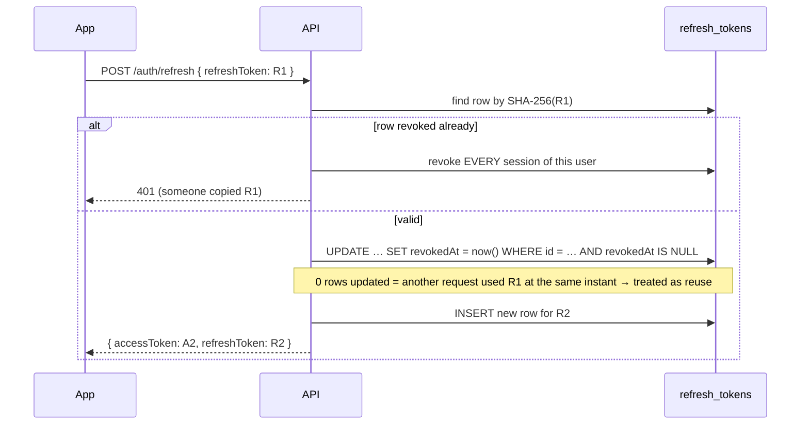
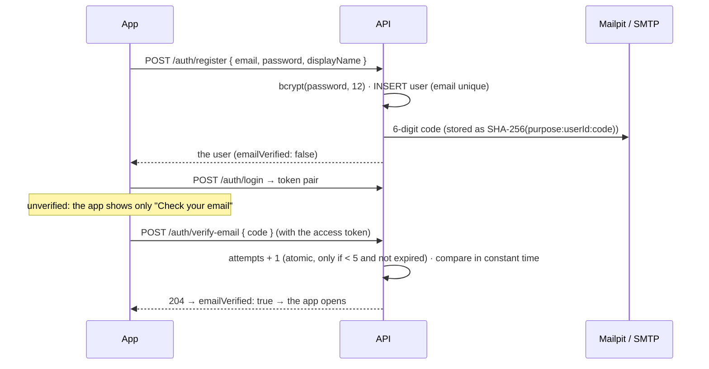
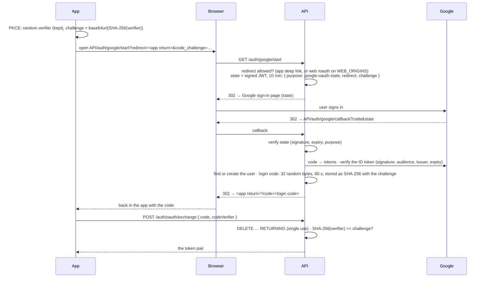
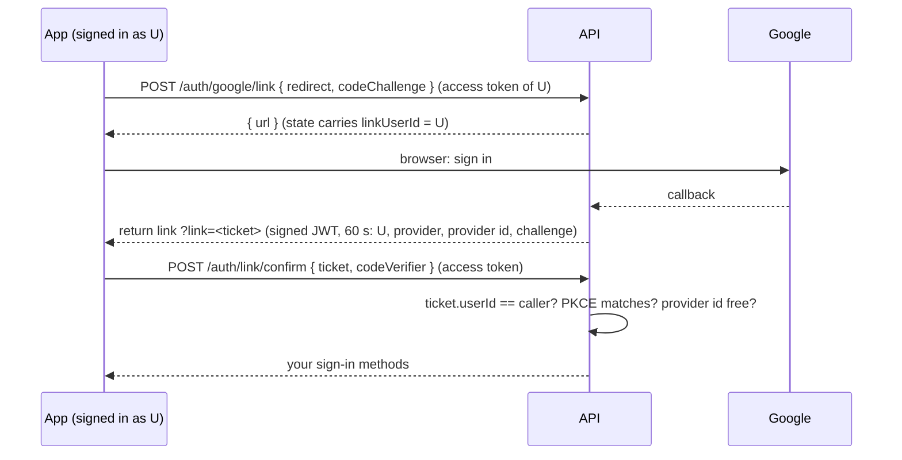

# 4. Accounts and sign-in

Brief V.1: email + password with verification and reset, Google and Facebook sign-in, and linking them to an existing account. Brief V.6: lock after N failures, rate limits.

## The token pair

Every sign-in (password, Google, Facebook) ends the same way: `AuthService.issueTokens()` returns

| | Access token | Refresh token |
|---|---|---|
| What | A **JWT** signed with `JWT_ACCESS_SECRET`: `{ sub: userId, email }` | **32 random bytes** (base64url), opaque, not a JWT |
| Lives | **15 minutes** | **7 days** |
| Sent | `Authorization: Bearer …` on every request, and in the socket handshake | Only to `POST /auth/refresh` and `/auth/logout` |
| Stored on the server | Nowhere: checked by its signature (stateless) | A row in `refresh_tokens` with its **SHA-256**, expiry and `revokedAt` |
| Stored in the app | **Memory only** | Mobile: the OS keychain / keystore (`expo-secure-store`). Web: `localStorage` |

**Why two tokens:**
- The access token is checked on every request without a database read. That makes it fast, but it can't be revoked, so it's short-lived.
- The refresh token **can** be revoked (logout, password reset, theft), because it's a database row.

### Rotation and theft detection



Each refresh **rotates** the token: R1 dies, R2 is born. If R1 is ever presented again, someone has a copy (the real app already moved on to R2). The API then revokes every session of that user, and everyone signs in again.

The consequence for the apps: **never send two refreshes at once.** Both apps share a single refresh promise ("single-flight") between all the requests that got a 401. The web app also locks it **across tabs**: see [The apps](08-apps.md#the-session).

## Register, verify, log in



**Passwords:**
- bcrypt, cost 12, 8 to 72 characters. 72 is bcrypt's limit: longer would be silently cut.
- Unknown emails are compared against a **dummy hash**, so they take as long as a wrong password. The response time doesn't reveal which emails exist, and the message is always "Invalid email or password".

**Email codes** (verification and reset share `one-time-code.ts`):
- 6 digits from `crypto.randomInt`;
- valid **15 minutes**;
- **5 attempts**, counted by one atomic `UPDATE … WHERE attempts < 5 AND expiresAt > now()`, so parallel guesses can't get past 5;
- **60 s** between resends;
- hashed with the purpose and the user id, so a verification code can never pass as a reset code;
- compared with `timingSafeEqual`.

**Reset password:**
- `POST /auth/forgot-password` always answers 204 at once and does the work in the background, so it never reveals whether the email has an account. For the same reason, its cooldown is silent.
- `POST /auth/reset-password` sets the new password and, in one transaction:
  - marks the email verified (the code came by email);
  - lifts a lockout;
  - deletes the code;
  - **revokes every session** (whoever knew the old password may be signed in somewhere).

## Lockout (V.6)

**5 wrong passwords in a row lock the account for 15 minutes**, even against the right password. The answer is 429 with `retryAfterSeconds`.

The count is one atomic SQL statement:

```sql
UPDATE users SET
  "failedLoginCount" = CASE WHEN "failedLoginCount" + 1 >= 5 THEN 0 ELSE "failedLoginCount" + 1 END,
  "lockedUntil"      = CASE WHEN "failedLoginCount" + 1 >= 5 THEN now() + interval '15 min' ELSE "lockedUntil" END
WHERE id = $1 RETURNING …
```

So 20 simultaneous wrong attempts all count. A success resets the count, and a password reset unlocks immediately.

## Rate limits

Three limits, counted per minute in the API's memory (`security/rate-limit.ts`). Over a limit: **429** with `Retry-After`.

| Limit | Counted per | Default | Applies to | Stops |
|---|---|---|---|---|
| `general` | **verified** user id (else IP) | 300 / min | every route | flooding. Per user, not per IP: a whole Wi-Fi shares one IP |
| `account` | IP + email | 10 / min | routes marked `@AuthAttempt()` | guessing one account's password or code |
| `ip` | IP | 100 / min | routes marked `@AuthAttempt()` | trying many accounts from one machine |

`@AuthAttempt()` marks the routes where a password or code can be guessed: register, login, verify, resend, forgot, reset and the OAuth exchange. The same decorator documents their 429 in Swagger, so the docs can't drift from the code. The `general` limit only trusts a **verified** token: otherwise a forged token with a random id would get a fresh budget each time.

## Google and Facebook sign-in

The API is the OAuth client: the client secret never leaves the server. The app only opens a browser and receives a **single-use code** that only it can redeem.



**Why each piece:**
- **`state` is a signed, 10-minute JWT bound to its provider.** The callback can trust where to send the browser, a forged or late callback is refused, and a Google state can't be replayed into Facebook's callback.
- **The return address is allow-listed:**
  - `exp://…` (Expo Go);
  - `musicroom://…` (our own builds);
  - the web app's `/oauth` page on an **exact** origin from `WEB_ORIGINS` (no other path, query or fragment, no look-alike host; tested in `app-redirect.spec.ts`).

  A crafted link can't send a login elsewhere.
- **Only a 60-second, single-use code** travels in the return link, never tokens. It's consumed with `DELETE … RETURNING`, so two requests can't both use it.
- **PKCE:** even if another app or page caught the code, it can't redeem it without the verifier, which never left the app that started.

**Who is this person?** (`oauth-login.service.ts`)

| | Google (OpenID Connect: verified ID token, says if the email is verified) | Facebook (OAuth 2.0 + Graph API with `appsecret_proof`; doesn't say if the email is verified) |
|---|---|---|
| Provider id already linked | that user | that user |
| Same email exists | linked **only if Google verified the email**, else `account_exists` | **refused** (`account_exists`): never linked automatically |
| New | account with no password, email verified | account with no password, **email not verified**: our own code is sent |
| No email at all | — | `email_required` |

Errors come back as `?error=` in the return link, and the app shows a sentence for each one.
- `account_exists` deliberately doesn't say *how* that account signs in: that would tell anyone which method to attack.
- If two callbacks race to create the same new user, the unique constraints let one insert win; the other finds that row.

## Linking a provider to your account

"Link Google" on your profile. The danger is **login CSRF**: an attacker starts "link" on *their* account, then gets the victim to open the link and sign in with Google. If the callback linked directly, the victim's Google would end up attached to the **attacker's** account. From then on, "Continue with Google" would quietly put the victim inside the attacker's account, where everything they add (profile, playlists, votes) is visible to the attacker.

So the callback doesn't link anything:



Linking needs **the same signed-in user** who started it **and** the PKCE verifier of the app that started it.
- A provider account linked to someone else is refused with 409.
- Replacing an already-linked one silently is also refused: unlink it first.

**Unlinking can't lock you out.** One `UPDATE users SET googleId = NULL WHERE id = … AND (passwordHash IS NOT NULL OR facebookId IS NOT NULL)`. Two simultaneous unlinks (Google and Facebook on a password-less account) can't both pass, because Postgres re-checks the `WHERE` on the row after the first one commits. A password-less account sets a password with "Forgot password".

## Routes

| Route | Guard | Notes |
|---|---|---|
| `POST /auth/register`, `/auth/login` | — | `@AuthAttempt` |
| `POST /auth/refresh`, `/auth/logout` | — | the refresh token in the body; logout always 204 |
| `POST /auth/verify-email`, `/auth/resend-verification` | JWT | |
| `POST /auth/forgot-password`, `/auth/reset-password` | — | always the same answers |
| `GET /auth/{google,facebook}/start`, `/callback` | — | browser redirects |
| `POST /auth/oauth/exchange` | — | code + verifier |
| `GET /users/me/identities`, `POST /auth/{provider}/link`, `POST /auth/link/confirm`, `DELETE /users/me/identities/{provider}` | JWT | linking |

## Tests

- Unit:
  - `pkce.spec.ts`, `app-redirect.spec.ts` (API);
  - `pkce.test.ts`: the SHA-256 fallback against standard vectors (web).
- Against the running API:
  - `test:links`: state, PKCE, tickets, never locked out, racing unlinks;
  - `test:rate-limit`: the limits and the lockout.

## Files to open

| File | What |
|---|---|
| `apps/api/src/auth/auth.service.ts` | Register, login, lockout, refresh rotation, logout |
| `auth/one-time-code.ts`, `email-verification.service.ts`, `password-reset.service.ts` | Email codes |
| `auth/social-auth.controller.ts`, `oauth-state.service.ts`, `app-redirect.ts` | The browser flow, state, allowed return addresses |
| `auth/google-oauth.service.ts`, `facebook-oauth.service.ts`, `oauth-login.service.ts` | Providers, find-or-create, login codes |
| `auth/account-links.service.ts` | Link tickets, confirm, unlink |
| `auth/jwt.strategy.ts`, `socket-auth.ts` | Checking the access token on REST and sockets |
| `security/rate-limit.ts` | The three limits |
