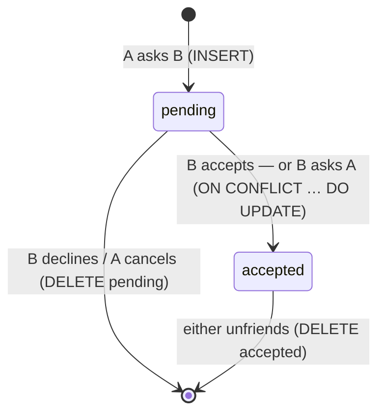
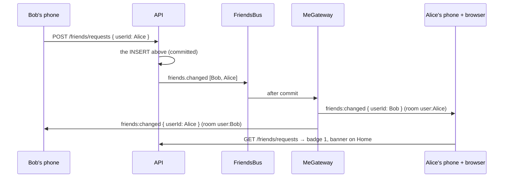

# 5. Profiles and friends

Brief V.1: a profile with **public**, **friends-only** and **private** information, plus **music preferences** whose visibility the user chooses. Friends decide what "friends-only" means.

## The four tiers

All the fields live on the `users` row. **One function decides what each viewer gets**: `profileFor()` in `users/profile-policy.ts`. Every route that shows a profile goes through it.

| Tier | Fields | Anonymous (no token) | Signed in, not a friend | Friend | Yourself |
|---|---|:-:|:-:|:-:|:-:|
| Public | `displayName`, `bio` | ✓ | ✓ | ✓ | ✓ |
| Friends only | `realName`, `city` | — | — | ✓ | ✓ |
| Private | `phone`, `birthDate` | — | — | — | ✓ |
| Music | `musicGenres`, `musicArtists` | if `public` | if `public` | if `public` or `friends` | ✓ |

- A tier the viewer may not see comes back as **`null`**. It isn't hidden by the app: it's simply not sent.
- **"Anonymous" exists because the brief wants profiles readable by API integrators without an account.** `GET /users/:id` and `GET /users?q=` use `OptionalJwtAuthGuard`. With no token you get the anonymous view. With an **expired** token you get a 401, so the app refreshes instead of silently showing less.
- `relation` (`self` / `friend` / `other` / `anonymous`) and `friendship` (`none` / `request_sent` / `request_received` / `friends`) come with the profile, so the app knows which button to show.

**Editing** (`PATCH /users/me/profile`): only the fields sent are changed; `""` from the app becomes `null`.
- **Genres** are structured tags from a fixed list, checked by validation and by a database `CHECK`. That way they can drive suggestions later; free text couldn't.
- **At most 10 artists** (also a `CHECK`).
- `birthDate` must be a real past date.

**Search** (`GET /users?q=`):
- by display name, `ILIKE` with `%` and `_` escaped (searching "50%" doesn't match everyone);
- public info only;
- 20 results;
- yourself left out.

## Friends: one row per pair

```
friendships (userAId, userBId) PRIMARY KEY, CHECK (userAId < userBId), requesterId, status
```

"Alice asks Bob" and "Bob asks Alice" are **the same primary key**: the pair is always stored with the smaller id first. So two people asking each other at the same instant can't create two rows.



A request is one statement:

```sql
INSERT INTO friendships ("userAId", "userBId", "requesterId", "status") VALUES ($1, $2, $me, 'pending')
ON CONFLICT ("userAId", "userBId") DO UPDATE
  SET "status" = 'accepted', "acceptedAt" = now()
  WHERE friendships."status" = 'pending' AND friendships."requesterId" <> EXCLUDED."requesterId"
RETURNING "status"
```

- A request **from the other person** is already waiting → it becomes a friendship: both asked.
- Asking **twice** → the `WHERE` is false, nothing changes, and `RETURNING` gives no row, so nobody is notified.
- Two simultaneous inserts of the same pair → Postgres makes the second wait for the first, then takes the `ON CONFLICT` branch.

Accept, decline, cancel and unfriend are each **one `UPDATE` or `DELETE`** with the expected status in the `WHERE`. They're idempotent and need no lock.

**Unfriending** immediately changes what each of you can see, because `profileFor()` reads the friendship on every request.

## Live friend notifications: `/me`



- On connection, the socket is put in **its own user's room**, chosen from the token. There's no "join" message, so nobody can listen to someone else.
- The message only says **who** changed. The app then reloads what it shows (requests, friends, that profile), with the normal access checks.
- Every device of the user is in the room: phone, emulator, browser tabs.

## Routes

| Route | Notes |
|---|---|
| `GET /users/me` | your account (`emailVerified` included) |
| `GET` / `PATCH /users/me/profile` | your full profile / edit it |
| `GET /users/:id` | anyone's profile, filtered for you (token optional) |
| `GET /users?q=` | people search (token optional) |
| `GET /friends` · `GET /friends/requests` | friends / `{ incoming, sent }` |
| `POST /friends/requests { userId }` | ask (or accept, if they asked you) |
| `POST /friends/requests/:userId/accept` | accept |
| `DELETE /friends/requests/:userId` | decline or cancel |
| `DELETE /friends/:userId` | unfriend |

## Tests

- `profile-policy.spec.ts`: every tier × every relation.
- `friendship.entity.spec.ts`: the pair order.
- `test:friends-race`: two people asking each other at once end up as friends; no duplicates.
- `test:me-realtime`: who receives which notification.
- `test:idor`: someone else's token on every profile and friend route.

## Files to open

| File | What |
|---|---|
| `apps/api/src/users/profile-policy.ts` | `canSee`, `profileFor`: the whole visibility rule |
| `users/users.service.ts`, `users.controller.ts` | Profile, edit, search |
| `friends/friendship.entity.ts` | The pair rule (`pairOf`) |
| `friends/friends.service.ts` | Requests, accept, drop, unfriend: one statement each |
| `me/me.gateway.ts` | The `/me` namespace |
