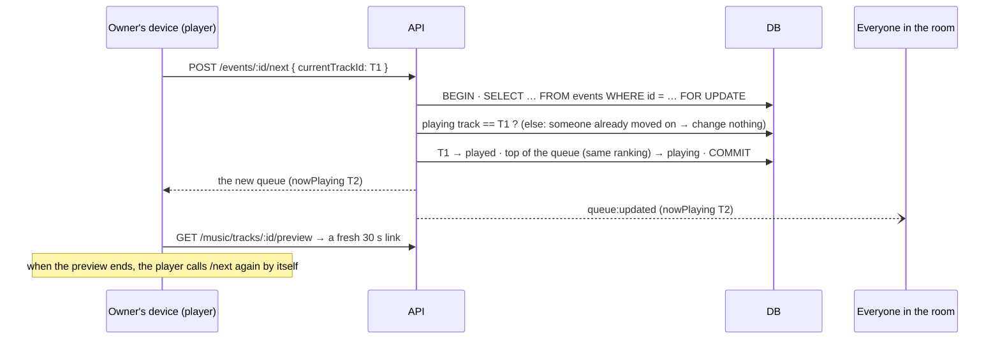

# 6. Track Vote (V.2.1)

A party with one shared queue:
- people **suggest** tracks and **vote** for what plays next;
- the most-voted track plays first;
- the **owner's device is the speaker**;
- everyone sees every change live.

## Who can do what

Two settings per event, decided by **pure functions** in `events/event-policy.ts`. The REST routes and the socket `event:join` both call them, so the rules can't drift apart.

**Visibility: who can see it** (`canView`)

| | Not a member | Member |
|---|---|---|
| `public` | ✓ (listed for everyone, joinable) | ✓ |
| `private` | **404**: as if it didn't exist | ✓ |

**License: who can vote and suggest** (`canParticipate`). The owner always can.

| License | Who | Refusal reasons |
|---|---|---|
| `open` | anyone who can see it | — |
| `invited` | accounts the owner **invited by email** (role `invited`) | `not_invited`. The invite code lets people in to watch (role `guest`), not to vote |
| `geo` | anyone who can see it, **during the window**, **within the radius** | `not_started`, `ended`, `location_required`, `outside_area` |

**Members and roles** (`event_members`):
- `owner`: created it.
- `invited`: invited by email (`POST /events/:id/invites`); a guest is upgraded.
- `guest`: joined a public event, or used the 8-character invite code.

Joining never downgrades a role (`INSERT … ON CONFLICT DO NOTHING`).

**Geo voting.** The app sends its location with each vote / suggestion, or as `?lat&lng` on `GET`. The server measures the **great-circle distance** (haversine) to the event's centre.
- The location comes from the device, so it's **untrusted**: GPS can be faked.
- Every geo decision is logged with the rounded position, and votes are rate-limited.
- This is listed as an accepted risk in [security.md](../security.md).

`GET /events/:id` returns `participation: { allowed } | { allowed: false, reason }`, so the app can explain *why* before you try.

## The ranked queue

`event_tracks` holds every suggestion with a `status`: `queued` → `playing` → `played`.

**The ranking rule:** most votes first. At equal votes, the **earliest suggestion first**, so two tracks with the same score never swap places. The id comes last only to make the order fully deterministic.

```sql
ORDER BY score DESC, "suggestedAt" ASC, id ASC
```

The same rule exists once in the shared package, `compareQueueTracks()`. The app uses it to reorder **instantly** after your own vote, before the server's answer arrives.

**Suggesting** (`POST /events/:id/tracks { providerTrackId }`):
- The server fetches the track from Deezer itself. Title, cover and duration are never taken from the app.
- The partial unique index `(eventId, provider, providerTrackId) WHERE status = 'queued'` refuses the same song twice in the waiting queue (409). Once played, it can be suggested again.

## Votes under concurrency

The brief's test plan: 10 people voting at the same instant must give **exactly** 10.

```sql
BEGIN;
  INSERT INTO votes ("eventTrackId", "userId") VALUES ($track, $me)
    ON CONFLICT DO NOTHING RETURNING "userId";          -- the (track, user) primary key
  -- only if a row was inserted:
  UPDATE event_tracks SET score = score + 1 WHERE id = $track RETURNING score;
COMMIT;
-- after commit: bus 'queue.changed'
```

- **One vote per person per track.** The primary key `(eventTrackId, userId)` lets exactly one of N identical simultaneous votes insert. The others insert nothing and don't touch the score. Voting twice is therefore **not an error**: it answers the current state.
- **No lost update.** `score = score + 1` is computed **inside** the database: Postgres locks the row and applies concurrent increments one after another. A read-modify-write in the app (`score = 7 + 1`) would lose votes.
- **The vote row and the score can't disagree**: they're in the same transaction.
- **Un-voting** is the mirror image: `DELETE … RETURNING`, and `score - 1` only if a vote really existed.
- **Only queued tracks** take votes. A track that just started playing answers 409.

## Playback: the owner's device is the speaker



- **`FOR UPDATE` on the event row** makes concurrent `next` calls for the same event run one after the other.
- **`currentTrackId`** is what the owner's device *thinks* is playing. If it's no longer true (a double tap, two of the owner's devices, the automatic "preview ended → next" racing a manual Next), nothing happens. So two songs are never skipped at once.
- **The partial unique index `(eventId) WHERE status = 'playing'`** guarantees at most one playing track, whatever happens.
- Only the **owner** controls playback (403 otherwise). Everyone else sees "Now playing" from the broadcasts.
- **What the music is.** Deezer's public API gives **30-second previews** (no account, no key). Links expire after about 15 minutes, so the player asks for a fresh one right before each track. A track with no preview is skipped.

## Live updates (`/events` namespace)

1. Each change publishes `queue.changed` on the bus **after commit**.
2. The gateway waits **100 ms**, then reads the ranked queue **once**.
3. It sends `queue:updated` with the **whole queue** to the room `event:<id>`.

So a burst (10 phones voting in the same second) costs 1 or 2 broadcasts instead of 10. A full snapshot is used because one vote can reorder everything; a snapshot is always correct, whatever was missed.

**The broadcast has no `votedByMe`**: it's the same for everyone. Each app keeps its own votes from `GET /queue` and from its own vote / unvote answers.

| Message | When | The app |
|---|---|---|
| `queue:updated` | suggest, vote, un-vote, next | replaces the queue (keeping its own `votedByMe`) |
| `event:updated` | settings changed, someone invited | reloads the details (participation may change) |
| `event:access-lost` | you can't see it any more (e.g. it became private) | leaves the page |
| `event:deleted` | the owner deleted it | says so, leaves the page |

## Routes

| Route | Who |
|---|---|
| `POST /events` · `GET /events` (public + mine, newest first) | signed in |
| `GET /events/:id[?lat&lng]` | can view |
| `PATCH` / `DELETE /events/:id` | owner. Switching to `geo` needs all 5 geo fields; other licenses refuse them |
| `POST /events/:id/join` · `POST /events/join { inviteCode }` | public event / anyone with the code |
| `POST /events/:id/invites { email }` | owner |
| `GET /events/:id/queue` | can view (with your `votedByMe`) |
| `POST /events/:id/tracks` · `POST` / `DELETE …/tracks/:trackId/vote` | can participate |
| `POST /events/:id/next { currentTrackId }` | owner |

## Tests

- Unit:
  - `event-policy.spec.ts`: every license × role × time × distance;
  - `ranking.spec.ts`: ranking and tie-break.
- `test:race`:
  - A: 10 users vote at the same instant → score exactly 10;
  - B: one user sends the same vote 10 times at once → still one vote;
  - C: they remove it 10 times at once → one removal;
  - D: a fresh race on a second track;
  - E: the real queue order (no votes, one vote, a tie, all tied).
- `test:realtime`: connecting (token), one vote reaching every listener, a burst of 10 votes batched, non-members removed when the event turns private, deletion.
- `test:idor`: another user's token on every event route, including `next` (owner only).
- **Not raced by a script:** two simultaneous `next` calls. That is guaranteed by the `FOR UPDATE` lock, the `currentTrackId` check and the one-playing-track unique index described above.

## Files to open

| File | What |
|---|---|
| `apps/api/src/events/event-policy.ts` | `canView`, `canParticipate`, `distanceMeters` |
| `events/events.service.ts` | Create, list, view, settings, join, invite |
| `events/queue.service.ts` | Ranking, suggest, **vote / unvote**, **next** |
| `events/event-track.entity.ts`, `vote.entity.ts` | The partial unique indexes, the vote key |
| `events/events.gateway.ts`, `events-bus.ts` | Rooms, batching, access re-checks |
| `packages/shared/src/index.ts` | `compareQueueTracks`, `QueueView`, the socket message types |
