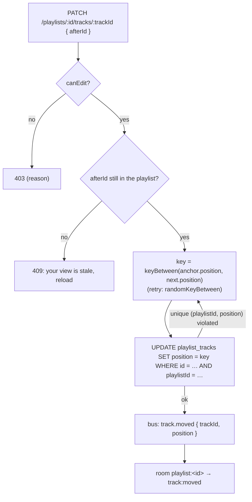

# 7. Playlist Editor (V.2.3)

A playlist several people edit **at the same time**: add, remove and reorder tracks. Everyone sees every change live, and nobody waits for a lock.

## Who can do what

Same model as events (`playlists/playlist-policy.ts`):

| Setting | Values |
|---|---|
| **Visibility** (`canViewPlaylist`) | `public`: everyone · `private`: members only (others get 404) |
| **License** (`canEdit`) | `open`: anyone who can see it edits · `invited`: only the owner and accounts invited by email. Everyone who can see it can **listen** |

Roles: `owner` · `invited` · `guest`. The invite code makes you a guest, which doesn't let you edit an `invited` playlist.

## The problem: order under concurrency

The naive model gives each track an integer `index` 0, 1, 2…
- Moving one track means renumbering every track between the old and the new place.
- Two people reordering at once then fight over the same rows: you need a lock, someone waits, and someone's move can be lost.

## The solution: fractional positions

Each track has a **position**: a string key. The playlist is sorted by these keys, compared **byte by byte** (`COLLATE "C"` in Postgres, plain `<` in JavaScript, never `localeCompare`). Putting a track somewhere means giving it **a key strictly between its new neighbours' keys**. No other row changes.

```
before:   a0 "Get Lucky"   a1 "One More Time"   a2 "Around the World"
move "Around the World" between the first two:
          keyBetween("a0", "a1") = "a0V"
after:    a0 "Get Lucky"   a0V "Around the World"   a1 "One More Time"
```

- Keys come from the `fractional-indexing` library (the same one in the API and the apps).
- `null` means "no neighbour": `keyBetween(null, "a0")` goes before the first track, `keyBetween("a2", null)` after the last.
- Every change is **one single-row `INSERT` or `UPDATE`**. Two people moving *different* tracks touch *different* rows, so **nothing ever waits**.

**The one conflict left.** Two people put a track into **the same gap at the same instant**. They read the same neighbours, so they compute the same key. The unique index `(playlistId, position)` makes the second write fail. The service then:
1. re-reads the neighbours as they are **now**;
2. tries again, this time at a **random spot** in the gap (`randomKeyBetween`: a short random walk), so N people retrying don't collide again;
3. stops after 10 attempts with a 409 "Many people are editing this spot right now".



**The API takes "after which track", not a key.**
- **Moving** sends `afterId`: the track it should come right after, or `null` for the top.
- **Adding** (`POST …/tracks { providerTrackId }`) puts the track at the end.

The server computes the key from the neighbours **in the database now**, so a client with a stale view can't corrupt the order. If the anchor vanished (removed by someone else), the answer is 409 and the app reloads.

**Other guarantees:**
- **The same song once per playlist:** unique `(playlistId, provider, providerTrackId)` → 409 "already in the playlist".
- **Remove is idempotent.** Removing a track that's already gone is fine; only the request that actually deleted it announces it.
- **A track moved and removed at the same moment:** the `UPDATE` finds 0 rows → 404. The move and add answers are built from what was written, not re-read, so a parallel delete can't turn them into a 500.
- **Key length:** each insert into the *same* gap can make the key a bit longer (about 1 character per 4–5 inserts in the worst case). The column holds 255 characters, far beyond any realistic use; `keysBetween` exists to respread a playlist if it ever came close.

## Live changes (`/playlists` namespace)

Unlike Track Vote, the server sends **small change messages**, not the whole list:

| Message | Payload | The app |
|---|---|---|
| `track:added` | the whole track (with its position) | upsert by id, then sort by position |
| `track:moved` | `trackId`, `position` | set that track's position, sort (ignore it if the track isn't there) |
| `track:removed` | `trackId` | drop it |
| `playlist:updated` | — | reload the details (`canEdit` may change) |
| `playlist:deleted` / `playlist:access-lost` | — | stop the music if it's this playlist, leave |

**Deltas are safe here** because a position is **absolute**. "Track X is now at key P" means the same thing whatever else happened, so the messages can be applied on their own, in any order, and every device ends up sorted the same way as the database. The test proves it: 30 concurrent edits, and every device's list equals the server's.

**Your own edits are shown at once (optimistic):**
1. The app moves the row immediately and predicts its key with the same `generateKeyBetween` the server uses (`guessPosition`).
2. The server's answer and the `track:moved` broadcast then confirm or correct it.
3. On any error, the app shows the message and reloads the server's list as the truth.

## Playing a playlist

Clicking a track plays it, then the player continues **in the playlist's current order**. At the end of each preview it re-reads the tracks and takes the one after the current one, so others' moves and removals are respected. If the current track was removed meanwhile, it continues from where it was. See [The apps](08-apps.md#the-player).

## Routes

| Route | Who |
|---|---|
| `POST /playlists` · `GET /playlists` (public + mine, recently edited first) | signed in |
| `GET` / `PATCH` / `DELETE /playlists/:id` | can view / owner / owner |
| `POST /playlists/:id/join` · `POST /playlists/join { inviteCode }` · `POST /playlists/:id/invites { email }` | as for events |
| `GET /playlists/:id/tracks` | can view (already sorted) |
| `POST /playlists/:id/tracks { providerTrackId }` | can edit (at the end) |
| `PATCH /playlists/:id/tracks/:trackId { afterId }` | can edit (move) |
| `DELETE /playlists/:id/tracks/:trackId` | can edit |

## Tests

- Unit:
  - `positions.spec.ts`: keys between neighbours, the ends, 200 inserts into one gap, `COLLATE "C"` order, random keys, rebalancing, wrong-order neighbours;
  - `playlist-policy.spec.ts`.
- `test:playlist-race`:
  - A: 10 people move 10 different tracks to the top at the same instant;
  - B: 10 people insert 10 songs right after the same track at once (every insert lands, the order stays strict);
  - C: 2 people move the same track to two places at once → both succeed, the last write wins: the track appears once, at one of the two places, all positions distinct;
  - D: edge cases: anchor just removed → 409, after itself → 400.
- `test:playlist-realtime`: 30 concurrent edits → every client's list == the server's.
- In the browser (web app check): reorder by keyboard, mouse and arrows, another account seeing the moves live.

## Files to open

| File | What |
|---|---|
| `apps/api/src/playlists/positions.ts` | `keyBetween`, `randomKeyBetween`, `byPosition` |
| `playlists/playlist-tracks.service.ts` | Add, **move**, remove, the retry |
| `playlists/playlist-track.entity.ts` | `COLLATE "C"`, the two unique indexes |
| `playlists/playlist-policy.ts` | `canViewPlaylist`, `canEdit` |
| `playlists/playlists.gateway.ts` | The delta messages |
| `apps/mobile/src/playlists/order.ts` (same in `apps/web`) | Sorting, `guessPosition`, `afterIdAt` |
