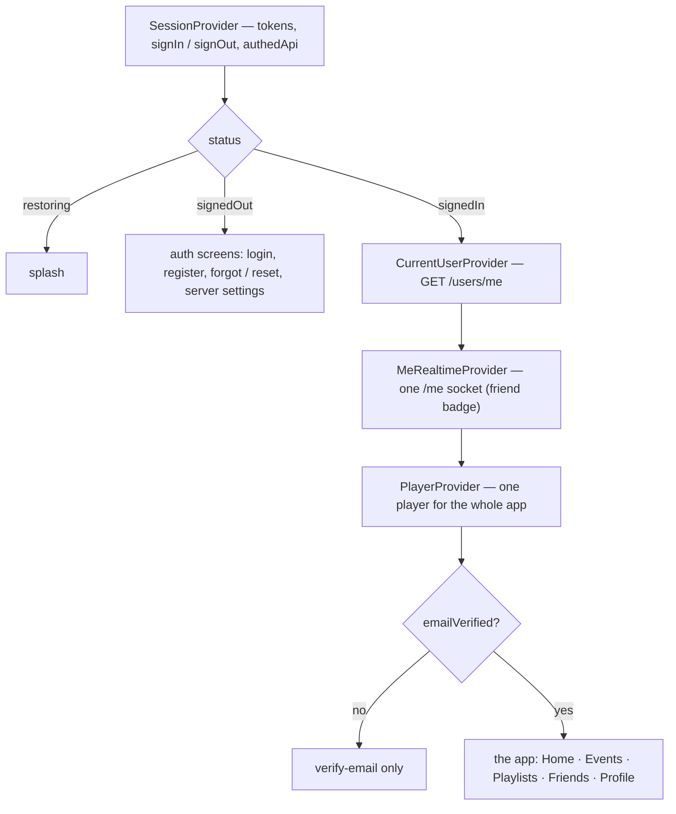
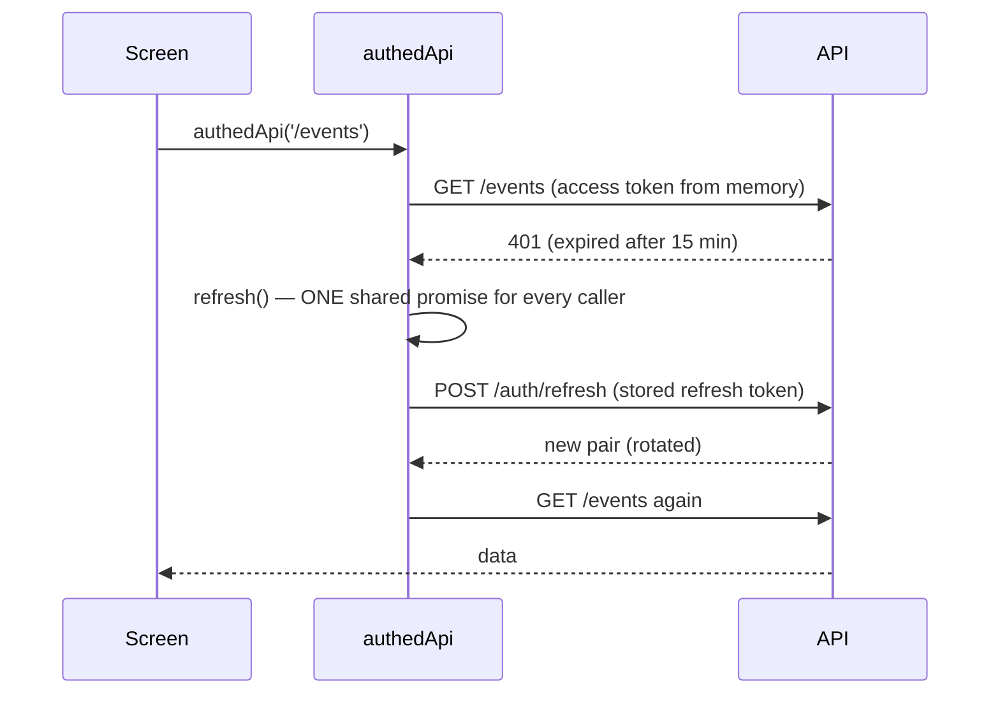

# 8. The apps (mobile and web)

Two clients, one design:
- **`apps/mobile`**: React Native with Expo SDK 57 and expo-router, for Android and iOS.
- **`apps/web`**: React 19 with Vite 8 and React Router 7, for any browser, responsive.

Both talk to the same API with the same shared types, and have the same screens and the same HOLY palette. They hold **no business rule**: they show what the API returns and send what the user does.

## Structure

The same layers in both apps:

| Layer | Mobile (`apps/mobile/src`) | Web (`apps/web/src`) |
|---|---|---|
| Screens / routes | `app/`: each file is a route (expo-router) | `pages/` + the route tree in `App.tsx` |
| API client | `api/client.ts`: `fetch`, 10 s timeout, every error → one `ApiError` shape | the same file |
| Session | `session/SessionProvider.tsx` | `session/SessionProvider.tsx` (+ cross-tab lock) |
| Current user | `session/CurrentUserProvider.tsx` (`GET /users/me` once) | the same |
| Live updates | `events/useEventRealtime.ts`, `playlists/usePlaylistRealtime.ts`, `profile/MeRealtimeProvider.tsx` | `realtime/` (the same hooks) |
| Player | `player/PlayerProvider.tsx` (`expo-audio`) | `player/PlayerProvider.tsx` (one `<audio>`) |
| UI kit | `ui/` (Button, ListItem, Cover, TextField…) on `theme.ts` | `ui/` on `styles.css` (the same tokens as CSS variables) |
| Labels / ordering | `events/labels.ts`, `playlists/order.ts` | the same files |

**Providers wrap the signed-in area** (the same order in both):

**Exactly one set of screens is reachable at a time.**
- **Mobile:** `Stack.Protected` route groups.
- **Web:** a different `<Routes>` tree per state.

When the status changes, the other set disappears from history: "back" can't return to a screen you no longer have access to. The web app remembers the link you opened while signed out and goes there after you log in.

## The session

**`authedApi()`** adds the access token. On a 401 it refreshes **once** and retries **once**: the screen never sees an expired token.

**Single-flight refresh.** All the requests that get a 401 at the same moment share **one** `/auth/refresh`. The API rotates refresh tokens and treats a reused one as theft ([Accounts](04-auth.md#rotation-and-theft-detection)), so two refreshes in parallel would end the session everywhere.

**Sign-out is local first** (forget the tokens, switch screens), then tells the server (best effort). A generation counter stops a refresh that finishes *after* sign-out from resurrecting the session.

**Sockets** pass the token in the handshake through a *function*, so every reconnection sends the latest one. `connect_error: unauthorized` → refresh → reconnect.

**Where the refresh token lives:**
- **Mobile:** `expo-secure-store` (iOS Keychain / Android Keystore).
- **Web:** `localStorage`, an accepted risk explained in [security.md](../security.md).

**Two things only the web app needs:**
1. **Many tabs, one refresh token.** Refreshes are serialised across tabs with the **Web Locks API** (`navigator.locks`). Inside the lock, the tab reads the *latest* stored token, so tab B uses what tab A just rotated instead of the old one. Signing out in one tab signs out the others (`storage` event).
2. **`crypto.subtle` only exists on https and localhost.** A phone opening `http://192.168.x.x:5173` falls back to a small, tested SHA-256 (`session/sha256.ts`) for the PKCE challenge.

**Social login:**
- **Mobile:** an in-app auth session (`expo-web-browser`), back to `exp://…/--/oauth` or `musicroom://oauth`.
- **Web:** a **full-page redirect** to the API, then to Google. It comes back to `/oauth?code=…`, and the PKCE verifier waited in `sessionStorage` (this tab only). The `/oauth` page finishes exactly once, even though it can mount twice: in React's development mode, and when signing in swaps the route tree.

## Loading data and live updates on a screen

Every list or detail screen follows the same pattern:
1. **Load on show.** Mobile: `useFocusEffect` (coming back to the screen). Web: on open and when the tab becomes visible again.
2. **Join the room, then load**, and reload after each reconnection ([Architecture](02-architecture.md#realtime-how-a-change-reaches-every-screen)).
3. **Apply live messages** to the local state:
   - Track Vote: replace the queue;
   - Playlist: upsert / set position / drop, then sort by position.
4. **Your own action is shown at once**, then confirmed by the server:
   - A vote flips the pill and reorders with the shared `compareQueueTracks`; on error it flips back.
   - A move predicts its key with `guessPosition`; on error the app reloads the server's list.
5. **Errors:** the API's message is shown as it is. Validation errors (400) appear **under the field** they're about (`api/formErrors.ts`: the first word of a class-validator message is the field name).

The live indicator (`● Live`) shows the room's state: connecting, live, offline.

## The player

One player for the whole signed-in app, so the music keeps playing whichever screen you're on. On mobile the mini-player sits above the tabs; on the web the player bar sits at the bottom.

| Source | What happens at the end of a preview |
|---|---|
| **A party** (owner only: the device is the speaker) | `POST /events/:id/next { currentTrackId }`. The server moves the queue on; a double call can't skip two songs ([Track Vote](06-track-vote.md#playback-the-owners-device-is-the-speaker)) |
| **A playlist** | re-read the tracks, play the one after the current one **in the current order** |

- **Before each track:** `GET /music/tracks/:id/preview` gets a fresh 30-second link (they expire). A track without a preview is skipped.
- **One source at a time.** Starting another party or playlist asks first ("Stop the music?").
- **Following the party.** If a live `queue:updated` says another track is now playing (the owner pressed Next on another device), the player follows it.
- **Web only:**
  - media keys and the OS's "now playing" (Media Session API);
  - a volume control (remembered);
  - the track in the tab title;
  - if the browser blocks sound until the first click, a "Press play" message.

**Music search** goes through our API (`GET /music/search?q=`): the apps never call Deezer directly. The API can then reshape the data, keep the provider swappable, and look up a track's details itself when it's suggested or added.

## Layout and design

- **One palette, from the project's `palette.pdf`:** `#150B17` background, `#201723` surfaces, `#3C3640` raised, `#68525D` fills, `#D1CDCC` text.
- **Contrast-checked (WCAG):** text on the background is 12.2:1.
- **The palette's mauve** is only 2.7:1 on the background, so it's used for **fills** (buttons, selected chips, progress), never for text. Its readable tint `#9D9095` (6.3:1) is used for links and the playing track.
- **Mobile:** five tabs, with the mini-player above the tab bar.
- **Web:**
  - **≥ 900 px:** a sidebar, a full-width player at the bottom; the party page shows *now playing* next to the queue from 1100 px.
  - **Below 900 px:** the mobile layout (bottom tabs, the player right above them).
  - Checked with no horizontal overflow on every page at 390 px and 820 px.
- **Accessibility:**
  - Every icon button has a label.
  - Choice chips are radio groups.
  - Confirmations are modal dialogs (web: `<dialog>`).
  - Playlist reordering works with the keyboard on the web (focus the handle, Space, arrows, Space).

## The server address (V.5)

**Server settings** is reachable before signing in and from Profile.
- **Test connection** calls `/health`.
- **Save** stores the address on the device: Secure Store on mobile, `localStorage` on the web.
- Changing server signs you out first: accounts belong to one server.
- The address built into the app (`EXPO_PUBLIC_API_URL` / `VITE_API_URL`) is only the default.

The web app's origin must also be in that server's `WEB_ORIGINS`: CORS, plus the allowed social-login return.

## Who's calling (V.6)

Every request carries `X-Client-Platform`, `X-Client-Device` and `X-Client-Version`; every socket handshake carries `auth.client`. The API writes them into its action log.
- **Mobile:** `android` / `ios`, the phone model, the app version.
- **Web:** `web`, "Chrome on macOS", the package version.

They're for logging only: the API never trusts them for a decision.

## Files to open

| File | What |
|---|---|
| `apps/*/src/session/SessionProvider.tsx` | Tokens, single-flight refresh, sign-in / out |
| `apps/web/src/session/tokenStore.ts`, `oauthFlow.ts`, `pages/OAuthReturnPage.tsx` | Cross-tab lock, the web social-login flow |
| `apps/*/src/player/PlayerProvider.tsx` | The app-wide player, party vs playlist |
| `apps/mobile/src/app/(app)/(tabs)/events/[id]/index.tsx`, `apps/web/src/pages/events/EventPage.tsx` | The party screen: live queue, optimistic votes |
| `apps/mobile/src/app/(app)/(tabs)/playlists/[id]/index.tsx`, `apps/web/src/pages/playlists/PlaylistPage.tsx` | The playlist screen: live edits, drag to reorder |
| `apps/mobile/src/playlists/DragList.tsx`, `apps/web/src/playlists/SortableList.tsx` | Drag-and-drop (gesture-handler + Reanimated / dnd-kit) |
| `apps/mobile/src/theme.ts`, `apps/web/src/styles.css` | Every colour, spacing and radius |
| `apps/*/src/config.ts`, `settings` screen | The runtime server address |
